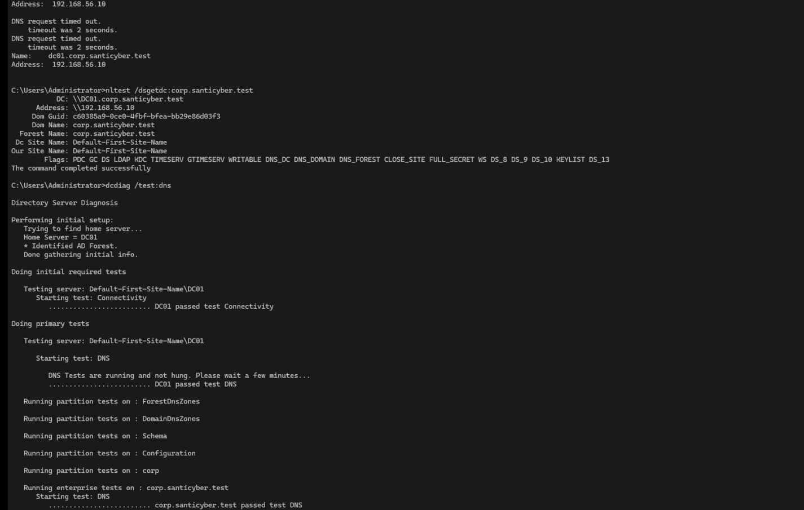
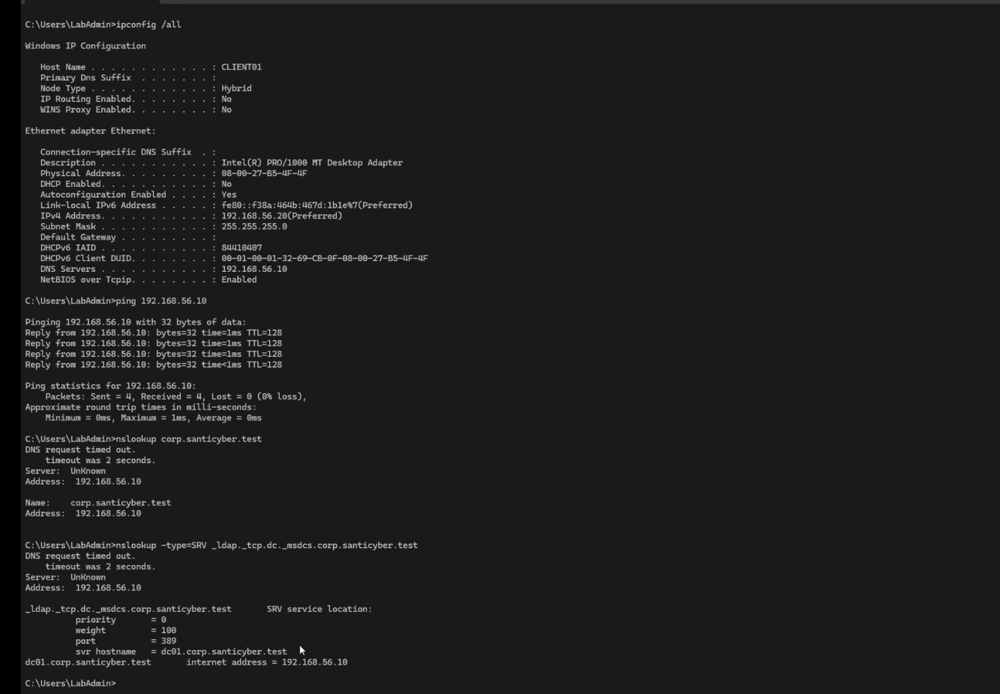
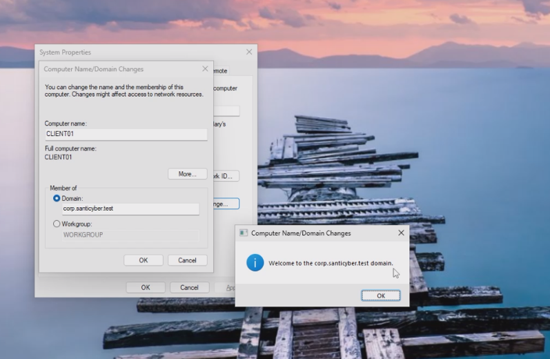
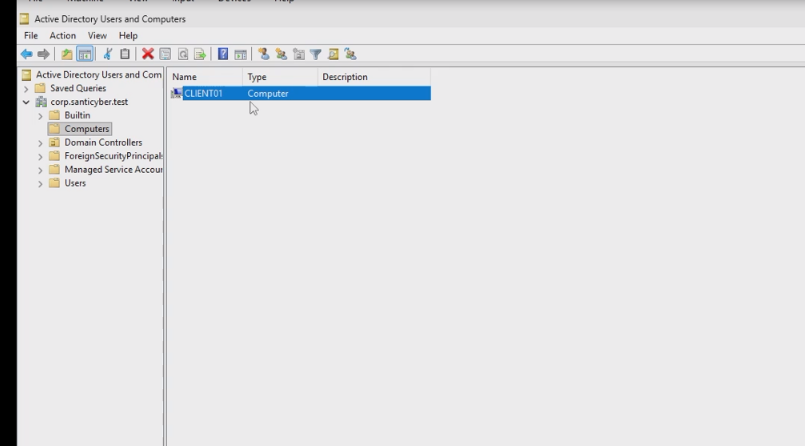
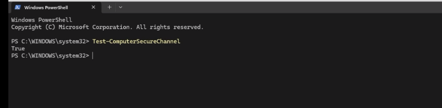
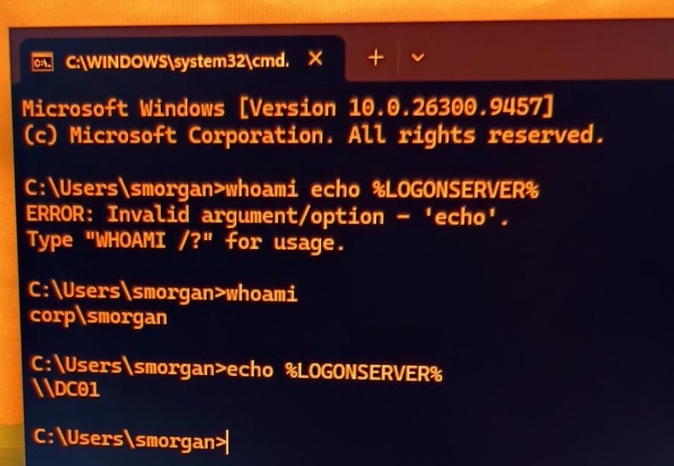

# Active Directory Corporate Environment

**Project status:** Core domain and workstation authentication verified (October 2026)  
**Environment:** Isolated VirtualBox home lab  
**Focus:** Windows Server administration, Active Directory, DNS, Windows 11 deployment, domain authentication, troubleshooting

## Overview

Built a small, fictional corporate Windows environment to practice skills relevant to IT support, desktop support, network troubleshooting, and later security investigations. The environment contains a Windows Server 2025 domain controller and a Windows 11 Pro employee workstation. The workstation was joined to the domain, and an employee's domain sign-in was verified.

This is **independent home-lab work**, not professional IT employment. Employee identities and the domain are fictional.

## Architecture

```text
Windows 11 host / Oracle VirtualBox
              |
     Internal network: CyberLab
          192.168.56.0/24
              |
      +-------+--------+
      |                |
  DC01                   CLIENT01
  Windows Server 2025    Windows 11 Pro
  192.168.56.10          192.168.56.20
  AD DS + DNS            DNS: 192.168.56.10
  corp.santicyber.test   Domain-joined workstation
```

- Domain: `corp.santicyber.test` (NetBIOS: `CORP`)
- DC01: 6 GB RAM, 2 vCPUs, 80 GB virtual disk; internal adapter attached to `CyberLab`
- CLIENT01: 6 GB RAM, 2 vCPUs, 80 GB dynamically allocated virtual disk; EFI, virtual TPM 2.0, Guest Additions
- Static IPv4 configuration; subnet mask `255.255.255.0`; no default gateway on the isolated network
- DC01 resolves DNS locally through its loopback interface; CLIENT01 queries DC01 at `192.168.56.10`

## Implementation

1. Installed Windows Server 2025 and configured the DC01 hostname and static IPv4 networking.
2. Installed Active Directory Domain Services and DNS; promoted DC01 for the `corp.santicyber.test` forest.
3. Validated domain-controller and DNS functionality using `nltest /dsgetdc:corp.santicyber.test` and `dcdiag /test:dns`.
4. Created CLIENT01 as a Windows 11 Pro VM with appropriate virtual hardware and an internal-network connection.
5. Configured CLIENT01 with static IPv4 `192.168.56.20/24` and DNS `192.168.56.10`.
6. Verified IP connectivity and Active Directory DNS discovery before attempting domain join.
7. Joined CLIENT01 to `corp.santicyber.test` using the Windows computer/domain membership dialog and authorized domain administrator credentials.
8. Created a fictional employee identity, **Sally MorganX** (`CORP\smorgan`), and signed in to CLIENT01 using the domain account.

## Verification evidence

| Verification | Result |
| --- | --- |
| CLIENT01 to DC01 `ping 192.168.56.10` | 4 sent, 4 received, 0 lost |
| `nslookup corp.santicyber.test` | Resolved to `192.168.56.10` |
| `nslookup -type=SRV _ldap._tcp.dc._msdcs.corp.santicyber.test` | Returned `dc01.corp.santicyber.test` at `192.168.56.10`, LDAP port 389 |
| Domain join | Windows displayed the welcome-to-domain confirmation |
| Windows domain membership | Remained present after reboot/reset |
| DC01 Active Directory Users and Computers | `CLIENT01` appeared in the **Computers** container |
| CLIENT01 PowerShell `Test-ComputerSecureChannel` | `True` |
| Employee session `whoami` | `corp\smorgan` |
| Employee session `echo %LOGONSERVER%` | `\\DC01` |

### Evidence gallery

The images below are real screenshots from this isolated home lab. The numbered filenames preserve the rough order of setup and verification. Click an image to inspect it in GitHub.

#### Domain controller diagnostics

The server's `nltest` output locates DC01, while `dcdiag /test:dns` reports successful DNS checks.



#### Workstation connectivity and DNS discovery

CLIENT01 has the intended static network settings, reaches DC01 with zero packet loss, and resolves both the domain address and LDAP SRV service. The initial `nslookup` timeout is retained as part of the actual troubleshooting record.



#### Successful domain join

Windows displayed the welcome message for `corp.santicyber.test` after CLIENT01 was joined.



#### Computer account in Active Directory

DC01's Active Directory Users and Computers console shows `CLIENT01` in the `Computers` container.



#### Secure channel and domain trust

After recovering from the frozen restart, CLIENT01 returned `True` for `Test-ComputerSecureChannel`.



#### Employee domain sign-in

Signed in to CLIENT01 as the fictional employee Sally MorganX. `whoami` returned `corp\smorgan` and `echo %LOGONSERVER%` returned `\\DC01`. The earlier command syntax error in this image is genuine and was corrected in the same session.



#### Additional configuration screenshots

- [01 — DC01 static IPv4 and DNS settings](evidence/01-dc01-static-ip-dns.png)
- [02 — AD DS and DNS roles visible in Server Manager](evidence/02-dc01-ad-dns-roles.png)
- [03 — Configuring the new Active Directory forest](evidence/03-dc01-domain-promotion.png)
- [05 — CLIENT01 VirtualBox internal network settings](evidence/05-client01-network-settings.png)
- [10 — Creating Sally MorganX's domain user account](evidence/10-sally-morganx-account-creation.png)

All 11 selected evidence images are stored in the project's [`evidence/` folder](evidence). No installer screenshots were added merely to inflate the project.


## Troubleshooting and lessons learned

**Guest display resolution:** The Windows 11 guest initially displayed black borders or an improperly scaled desktop. Guest Additions was installed, and switching VirtualBox display modes eventually produced a correctly fitting full-screen display. No rebuild was needed.

**DNS lookup timeout (follow-up on October 22, 2026):** Initial `nslookup` tests showed two-second timeouts and `Server: UnKnown`, although A/SRV records ultimately resolved. A reverse lookup zone and PTR record were subsequently added, resolving DC01 hostname identification. A separate [Lab 03 DNS troubleshooting investigation](../Network-DNS-Troubleshooting/README.md) reproduced the timeout, compared UDP/TCP, inspected debug logs, observed suffix-expanded lookups, and verified successful queries with a trailing dot or `-nosearch`. Suffix-search behavior is the leading explanation, but the exact timed-out transaction has **not** been definitively identified.

**Frozen restart after domain join:** CLIENT01 displayed a successful domain-join welcome message but froze during the subsequent restart. After resetting the unresponsive VM, Windows booted successfully and retained domain membership. The secure-channel check also passed. The underlying cause of the freeze was not established.

**Password policy rejection:** An initial password choice for the fictional employee account was rejected by Active Directory policy. A compliant password was used without weakening the domain policy.

**Command syntax correction:** Two verification commands were initially entered as one command and returned a syntax error. Executing `whoami` and `echo %LOGONSERVER%` separately returned the expected values.

## Skills demonstrated

- Virtual machine deployment and resource allocation
- Static IPv4 addressing, network connectivity checks, and DNS troubleshooting
- Windows Server AD DS and DNS configuration
- Active Directory computer and employee-account administration
- Domain joining, trust verification, and employee authentication
- Interpreting command-line evidence and documenting troubleshooting outcomes

## Next work

- Maintain and expand evidence only as further tests and real scenarios are completed
- Add focused build notes for DC01 and CLIENT01 as needed
- Establish a sound DC01 backup and recovery procedure before disruptive experiments
- Reuse the environment for group policy, permissions, help-desk incidents, network investigations, and defensive monitoring

The project is deliberately incremental: infrastructure is the foundation for operational and investigative scenarios, not the end goal.
